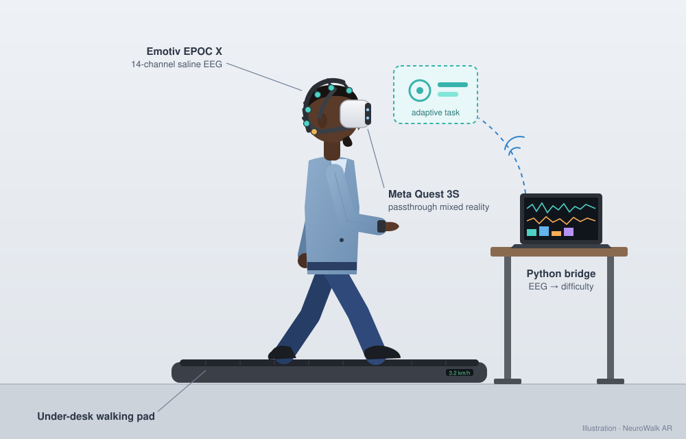

# NeuroWalk AR

**EEG-adaptive dual-task walking in passthrough mixed reality for gait rehabilitation.**

<p align="center">
  
</p>

NeuroWalk AR is a research and rehabilitation project. People recovering from
stroke, people living with Parkinson's disease, and people at risk of falling
often walk well when they can concentrate on walking, but struggle when they
have to think about something else at the same time. That second task can be
talking, reading a sign or crossing a busy street. Training **dual-task
walking** helps, but only when the task is hard enough to challenge someone
without overloading them, and the right level changes from minute to minute.

NeuroWalk AR adjusts the task difficulty continuously, based on the walker's
own brain activity:

1. The person walks on a treadmill wearing a **Meta Quest 3S** in passthrough
   mode, so they still see the real room around them. Simple cognitive tasks
   appear as AR overlays.
2. An **Emotiv EPOC X** (14-channel saline EEG) records brain activity at the
   same time.
3. A **Python bridge** reads band power from the Emotiv Cortex API every 2 s and
   computes workload markers: frontal theta/alpha and the engagement index
   beta / (alpha + theta).
4. A **per-user calibrated classifier** (LDA / logistic regression) estimates
   whether the walker is under-challenged, engaged or overloaded. The headset's
   motion sensor gates out movement artefacts.
5. A **difficulty controller** sends commands over Wi-Fi to the standalone Unity
   app on the Quest, which makes the task harder or easier.

The research pilot is a within-subject crossover comparing **adaptive** and
**fixed** difficulty.

## Hardware

| Device | Role |
|---|---|
| Emotiv EPOC X (14-ch saline EEG, 128/256 Hz, built-in motion sensor) | Brain activity and head motion |
| Meta Quest 3S | Passthrough mixed-reality task display (standalone Unity app) |
| Under-desk walking pad | Treadmill walking |
| Windows PC | Runs EMOTIV Launcher / Cortex and the Python bridge |

All software used is free. Phase 0 checks which Emotiv data streams a free
account can use.

## Roadmap

| Phase | Goal | Status |
|---|---|---|
| 0 | EEG only: first recording, eyes open/closed alpha check, find out which streams are free | **In progress**, see [`eeg/phase0`](eeg/phase0/README.md) |
| 1 | Python bridge with live band power, workload features and per-user calibration | Planned |
| 2 | Seated Quest AR task, difficulty controlled by the bridge over Wi-Fi | Planned |
| 3 | Walking: motion-based artefact gating and gait logging | Planned |
| 4 | Pilot study: adaptive vs fixed difficulty crossover | Planned |

## Repository layout

```
eeg/phase0/     Phase 0 recording script, offline tests and the EPOC X fitting guide
bridge/         PC-side tools that talk to the Quest app over Wi-Fi (quest_control.py)
docs/           Images used in this README
```

The Unity project for the Quest app is kept in a separate repository.

## Getting started

Start with the [Phase 0 guide](eeg/phase0/README.md). It covers fitting the
EPOC X, setting up a free Cortex App, and running a first eyes-open/eyes-closed
recording.

## Safety

This is a research prototype, **not a medical device**. The walking pad has no
handrails, so walking while wearing a headset needs a slow speed, a clear space,
and for any patient session a spotter or safety harness, under the supervision
of a qualified clinician. Never commit Cortex credentials or personal EEG
recordings. The `.gitignore` files exclude them.
